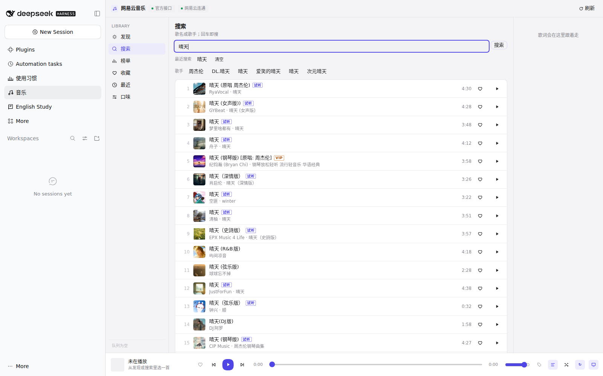
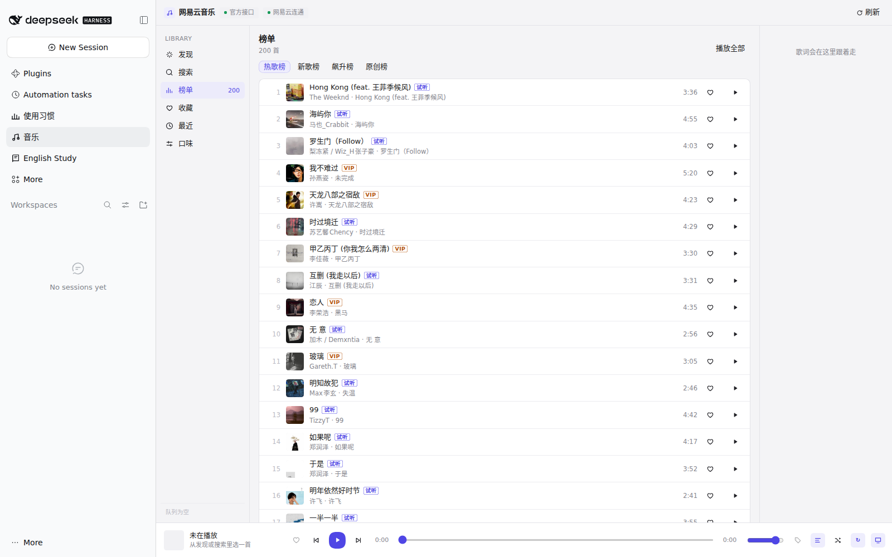
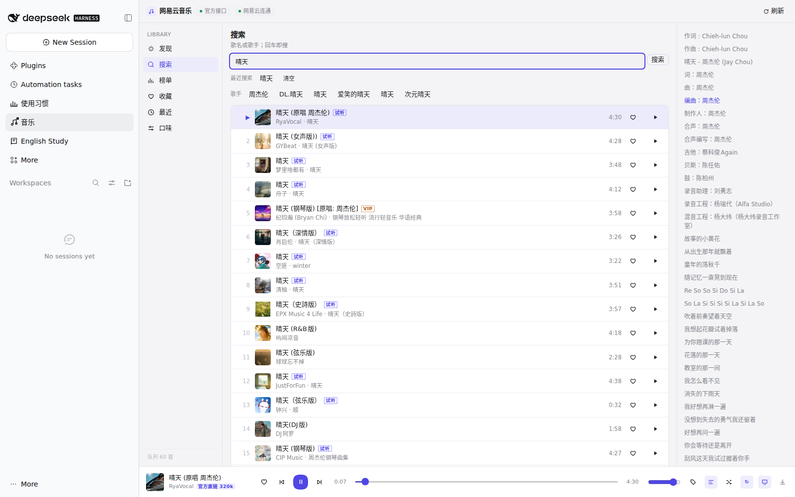

# dsh-music-panel

A NetEase Cloud Music (网易云音乐) panel plugin for **DeepSeek Harness** — search, charts, favorites, play history, lyrics and taste-based recommendations inside the DSH desktop web UI. **Official streams only: it never unlocks VIP or region-locked tracks.**


*Searching "晴天" — results come straight from the official NetEase Cloud Music API.*


*Hot chart — official stream, 200 tracks.*


*Now playing: official direct stream (320k) with scrolling lyrics and credits. No unlock, no third-party source.*

> 中文说明见下方 [中文](#中文说明)。

## What it is

`dsh-music-panel` adds a full music panel to DeepSeek Harness: a sidebar entry opens a Magpie-style page with search, charts, your favorites and play history, synced lyrics, and a recommendation feed built from your own listening profile. Audio is streamed through the plugin's own host routes, so the browser never talks to a third-party CDN directly.

Everything the plugin can play comes from the **official NetEase Cloud Music API**. If the official API refuses to hand out a playable URL for a track, the panel says so and stops there.

## Features

| Feature | Notes |
|---|---|
| Search | Songs and artists, with artist capsules to reach the original artist page |
| Charts | Hot / new / rising / original charts, arbitrary playlist IDs accepted |
| Favorites | Per-track favorites, stored locally |
| Play history | Play / skip / completion tracking, last 600 entries |
| Lyrics | Synced (LRC) plus translation lines when available |
| Taste profile | Weighted profile from favorites, plays and tags with time decay |
| Recommendations | Tag-based and profile-based discovery; optional Last.fm similarity |
| Player | Floating mini player, queue, shuffle/repeat, download of the official stream |

## Playback policy (please read)

- The plugin **does not unlock VIP tracks, paid albums, or region-restricted tracks**. It contains no third-party audio sources, no proxy tricks, no certificate handling and no external helper process.
- When the official API returns no URL (or only a trial fragment), `/api/url` and `resolve` return an explicit error: *"该曲目需要官方会员，本面板只播放官方允许的内容"* ("this track requires an official subscription; this panel only plays what the official service allows").
- Tracks that are free, unrestricted, or playable by **the account whose cookie you configured** work exactly as the official player does.

### How this differs from the unlocked personal build

This repository is a **clean, publishable copy** of a private build. The private build additionally wired in an in-process unlocker that searched other music providers for a playable URL. That whole path is removed here:

- no unlocker library and no third-party source matcher — no dependency, no import, no code path;
- no per-source ordering setting and no third-party source names anywhere in the code or UI;
- no "unlocking…" or unlock-engine version UI text.

If a track will not play here but does play in the private build, that is **the intended difference, not a bug**.

## Install

This is a local (`file:`) DSH plugin — it is not on npm.

1. Put this directory anywhere on disk, e.g. `/path/to/dsh-music-panel` (Windows: `D:/plugins/dsh-music-panel`).
2. In your DSH profile's `package.json` (typically `<DSH_HOME>/profiles/<profile>/package.json`), add the dependency:

   ```json
   {
     "dependencies": {
       "dsh-music-panel": "file:/absolute/path/to/dsh-music-panel"
     }
   }
   ```

3. In the same file, add the same name to `dsh.profile.bundles`:

   ```json
   {
     "dsh": {
       "profile": {
         "bundles": ["dsh-music-panel"]
       }
     }
   }
   ```

4. Make sure the plugin's own patch layer is applied. The repository ships `cordis.patch.yml`:

   ```yaml
   - insert:
       - id: dsh-music-panel
         name: 'dsh-music-panel'
         config:
           basePath: '/dsh-netease'
           quality: 'exhigh'
           cacheTtlMs: 600000
   ```

   If your profile keeps an aggregated patch file, insert the same block explicitly there instead of relying on discovery.

5. Install and restart DSH: run your package manager in the profile directory (e.g. `pnpm install`), then fully restart the desktop app. A reload is not enough — the host-side routes are registered at boot.

6. Open the panel from the music icon in the sidebar, or hit `http://127.0.0.1:<port>/dsh-netease/api/health` to confirm the routes are up.

> The panel page talks to a hard-coded route prefix that matches the default `basePath` (`/dsh-netease`). If you change `basePath`, also change `var API = '/dsh-netease'` in `lib/client.js`.

## Configuration

All keys are optional and live in the `insert` block of `cordis.patch.yml` (or the equivalent aggregated patch).

| Key | Default | Meaning |
|---|---|---|
| `basePath` | `/dsh-netease` | HTTP prefix for every route (`/api/search`, `/stream`, `/img`, …) |
| `quality` | `exhigh` | Requested bitrate: `standard` (128k) / `high` (192k) / `exhigh` (320k) / `lossless` (999k) |
| `cacheTtlMs` | `600000` | How long a resolved official stream URL is cached before re-resolving |
| `dataDir` | `<DSH_HOME>/dsh-music-data` | Where `library.json` (favorites / history / tags / shown) is written |
| `cookie` | `''` (env `NETEASE_COOKIE`) | Your own official login cookie, passed through verbatim — see below |
| `lastfmApiKey` | `''` (env `LASTFM_API_KEY`) | Last.fm application API key, used only to look up similar artists |

About `cookie`: it is a plain pass-through of **your own** NetEase session cookie. The plugin does not fabricate credentials, does not derive one for you, and does not use it to bypass anything — it only makes the official API behave like the official web player for your account. Leave it empty for anonymous mode.

The Last.fm key is an application key, not an account credential; it can also be set from the panel's settings dialog and is written to `<DSH_HOME>/dsh-music-data/settings.json`.

## Compatibility

- DeepSeek Harness **0.2.x**, desktop app, **web** frontend (`dsh.client.platform = "web"`, loads immediately).
- Node.js **≥ 20** on the host side (uses global `fetch`, `AbortSignal.timeout`, `Readable.fromWeb`).
- No runtime npm dependencies.
- Host routes are registered through `ctx.webServer.register({ kind: 'exact', … })`; the client bundle registers through `window.__ModuleLoader__`.

## Privacy

- **No telemetry, no analytics, no author-side server.** Nothing is sent to the plugin author.
- Requests go directly from your machine to `music.163.com` (and to `ws.audioscrobbler.com` only if you configure a Last.fm key).
- Favorites, play history, tags and search history are stored **locally** in `<DSH_HOME>/dsh-music-data/library.json`. Nothing is uploaded, and deleting that file resets the panel.
- UI preferences (volume, view mode, last search) live in the browser's `localStorage`.
- Cover images are proxied only for `*.126.net` / `*.163.com` hosts; arbitrary URLs are rejected.

## Known limitations

- **VIP / paid / region-locked tracks do not play.** This is by design.
- Anonymous mode (no `cookie`) gets noticeably worse search results: NetEase tends to bury VIP originals, and some official URLs come back empty. With your own cookie the results and direct links are closer to the web player. Neither mode unlocks anything.
- `/dsh-netease/api/health` still reports search-endpoint cooldowns; NetEase rate-limits its search API per path, and the plugin rotates across a host × path matrix with exponential backoff.
- Lyrics and cover art depend entirely on what the official APIs return; some tracks have neither.
- The panel is a single page in the `main` slot; there is no standalone web build.

## Development

```bash
node --check index.js
node --check lib/client.js && node --check lib/library.js && node --check lib/recommend.js
```

No build step, no bundler, no dependencies: `index.js` is loaded by the DSH host, `lib/client.js` is a `__ModuleLoader__` bundle evaluated by the web frontend.

## License

MIT — see [LICENSE](./LICENSE).

---

# 中文说明

一个 **DeepSeek Harness** 的网易云音乐面板插件：搜索、榜单、收藏、播放历史、歌词、按口味推荐。**只播放官方允许的内容，不提供任何 VIP / 区域限制解锁。**

> English docs above.

## 定位

`dsh-music-panel` 在 DSH 桌面端 Web 界面里加一整套音乐面板：侧边栏入口打开一个 Magpie 风格的整页，含搜索、榜单、收藏、播放历史、逐行歌词，以及按你自己听歌画像生成的推荐流。音频由插件自己的宿主路由转发，浏览器不直连第三方 CDN。

能播什么完全取决于**网易云官方接口**：官方不给可播地址，面板就明确说明并停在那里。

## 功能

| 功能 | 说明 |
|---|---|
| 搜索 | 歌曲 / 歌手，附歌手胶囊，可直达歌手页拿到被压掉的原唱 |
| 榜单 | 热歌 / 新歌 / 飙升 / 原创，也支持任意歌单 id |
| 收藏 | 单曲收藏，本地落盘 |
| 播放历史 | 播放 / 跳过 / 听完状态，最多保留 600 条 |
| 歌词 | 逐行 LRC，有翻译时同屏显示 |
| 口味画像 | 按收藏、播放次数、标签加权，带时间衰减 |
| 推荐 | 标签推荐 + 画像推荐，可选 Last.fm 相似歌手 |
| 播放器 | 浮动迷你播放器、队列、随机 / 循环、官方直链下载 |

## 播放授权声明（请先读这一段）

- 本插件**不解锁 VIP 曲目、付费专辑、区域限制曲目**。仓库里没有任何第三方音源、没有代理取流、没有证书处理、没有外部辅助进程。
- 官方接口不给可播地址（或只给试听片段）时，`/api/url` 与 `resolve` 会返回明确错误：**「该曲目需要官方会员，本面板只播放官方允许的内容」**。
- 免费曲目、无版权限制曲目、以及**你配置了 Cookie 的那个账号本身有权播放**的曲目，行为与官方播放器一致。

### 和带解锁的个人版有什么区别

本仓库是个人自用版的一个**可公开副本**。个人版额外接了一个进程内解锁器，会去其它音乐源搜可播地址；**这部分在本副本里已被整段摘除**：

- 不再声明、不再 import、也不再调用任何解锁器模块；
- 删掉了音源排序配置项，代码与 UI 里不再出现任何第三方音源名字；
- 删掉了「解锁中…」之类暗示第三方取流的界面文案。

同一首歌在个人版能播、在这里不能播，**这是设计差异，不是 bug**。

## 安装

这是一个本地（`file:`）插件，未发布到 npm。

1. 把本目录放到任意位置，例如 `/path/to/dsh-music-panel`（Windows：`D:/plugins/dsh-music-panel`）。
2. 在 DSH profile 的 `package.json`（一般是 `<DSH_HOME>/profiles/<profile>/package.json`）里加依赖：

   ```json
   {
     "dependencies": {
       "dsh-music-panel": "file:/absolute/path/to/dsh-music-panel"
     }
   }
   ```

3. 同一个文件里，把同名条目加进 `dsh.profile.bundles`：

   ```json
   {
     "dsh": {
       "profile": {
         "bundles": ["dsh-music-panel"]
       }
     }
   }
   ```

4. 确保插件的补丁层生效。仓库自带 `cordis.patch.yml`：

   ```yaml
   - insert:
       - id: dsh-music-panel
         name: 'dsh-music-panel'
         config:
           basePath: '/dsh-netease'
           quality: 'exhigh'
           cacheTtlMs: 600000
   ```

   如果你的 profile 用一份聚合补丁文件，请把同样的块**显式 insert** 进去，不要指望自动发现。

5. 在 profile 目录里装依赖（如 `pnpm install`），然后**完全重启 DSH 桌面端**。刷新页面不够——宿主路由是启动时注册的。

6. 从侧边栏的音乐图标打开面板；或直接访问 `http://127.0.0.1:<端口>/dsh-netease/api/health` 确认路由已起。

> 面板里的路由前缀是写死在 `lib/client.js` 的 `var API = '/dsh-netease'`，与默认 `basePath` 一致。改了 `basePath` 就要同步改这个常量。

## 配置项

全部可选，写在 `cordis.patch.yml` 的 `insert` 块里（或等价的聚合补丁）。

| 配置项 | 默认值 | 含义 |
|---|---|---|
| `basePath` | `/dsh-netease` | 所有路由的 HTTP 前缀（`/api/search`、`/stream`、`/img`…） |
| `quality` | `exhigh` | 请求码率：`standard`(128k) / `high`(192k) / `exhigh`(320k) / `lossless`(999k) |
| `cacheTtlMs` | `600000` | 官方直链缓存时长，过期后重新解析 |
| `dataDir` | `<DSH_HOME>/dsh-music-data` | `library.json`（收藏 / 历史 / 标签 / 已推荐）落盘目录 |
| `cookie` | `''`（环境变量 `NETEASE_COOKIE`） | **你自己的**官方登录态，原样透传，见下 |
| `lastfmApiKey` | `''`（环境变量 `LASTFM_API_KEY`） | Last.fm 应用 API key，仅用于查相似歌手 |

关于 `cookie`：它只是把你**自己的**网易云会话 Cookie 原样带上。插件不会伪造凭据、不会替你推导登录态、也不会拿它绕过任何限制——只让官方接口表现得像官方网页播放器。留空即匿名模式。

`lastfmApiKey` 是应用级 key（不是账号密码），也可以在面板的设置对话框里填，会落到 `<DSH_HOME>/dsh-music-data/settings.json`。

## 兼容性

- DeepSeek Harness **0.2.x**，桌面端，**Web** 前端（`dsh.client.platform = "web"`，随启动立即加载）。
- 宿主侧 Node.js **≥ 20**（用到全局 `fetch`、`AbortSignal.timeout`、`Readable.fromWeb`）。
- 无运行时 npm 依赖。
- 宿主路由走 `ctx.webServer.register({ kind: 'exact', … })`；客户端 bundle 走 `window.__ModuleLoader__`。

## 隐私

- **无遥测、无统计、无作者服务端**，不会向插件作者发送任何数据。
- 请求从本机直连 `music.163.com`；只有你配置了 Last.fm key 时才会访问 `ws.audioscrobbler.com`。
- 收藏、播放历史、标签、搜索历史**只存在本机** `<DSH_HOME>/dsh-music-data/library.json`，不上传；删掉该文件等于重置面板。
- 界面偏好（音量、视图、上次搜索）存浏览器 `localStorage`。
- 封面只代理 `*.126.net` / `*.163.com` 的地址，其它域名一律拒绝。

## 已知限制

- **VIP / 付费 / 区域限制曲目不能播**，这是设计选择。
- 匿名模式（不配 `cookie`）搜索结果明显更差：网易云会压掉 VIP 原唱，部分官方直链也会返回空。配上自己的 Cookie 后接近网页播放器。两种模式都不会解锁任何东西。
- `/dsh-netease/api/health` 会报搜索接口冷却状态：网易云按路径限流，插件用「域名 × 路径」矩阵加指数退避轮换。
- 歌词与封面完全取决于官方接口返回值，部分曲目两者都没有。
- 面板是 `main` 槽里的单页，没有独立 Web 构建。

## 开发

```bash
node --check index.js
node --check lib/client.js && node --check lib/library.js && node --check lib/recommend.js
```

没有构建步骤、没有打包器、没有依赖：`index.js` 由 DSH 宿主加载，`lib/client.js` 是交给前端 `__ModuleLoader__` 求值的 bundle。

## 许可

MIT，见 [LICENSE](./LICENSE)。

---

## Clean-install notes / 干净环境验收说明

- **A bare `http://127.0.0.1:<port>/` answering `401` is normal** when DSH runs as `dsh web`: the GUI is token-guarded. Use the `?token=...` URL printed at startup. `401` does **not** mean the plugin failed to load — plugin routes are served behind the same token.
  以 `dsh web` 方式运行时，GUI 带 token 鉴权，裸访问返回 **401 是正常的**，要用启动时打印的 `?token=` 链接；`401` 不代表插件没加载。
- **Verified on a clean environment** (fresh Ubuntu 24.04 + Node 24 + `@deepseek-ai/dsh`, no other plugins): the plugin loads with `failed: []`, all of its routes answer `200`, and its client bundle is present in the merged bundle.
  已在干净环境（全新 Ubuntu 24.04 + Node 24 + 单装 DSH，无其它插件）验证：插件加载 `failed: []`，所有路由 `200`，客户端 bundle 已打进合并包。
